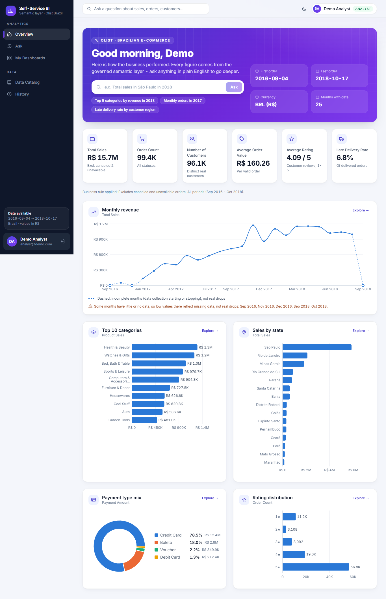
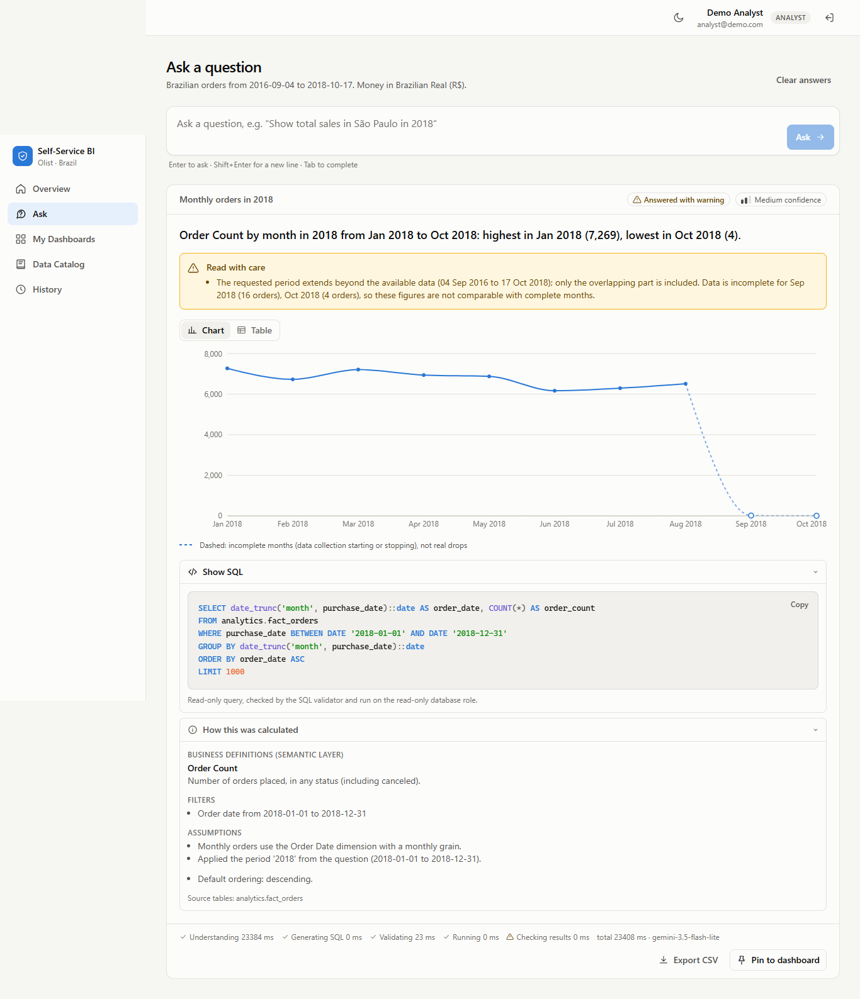
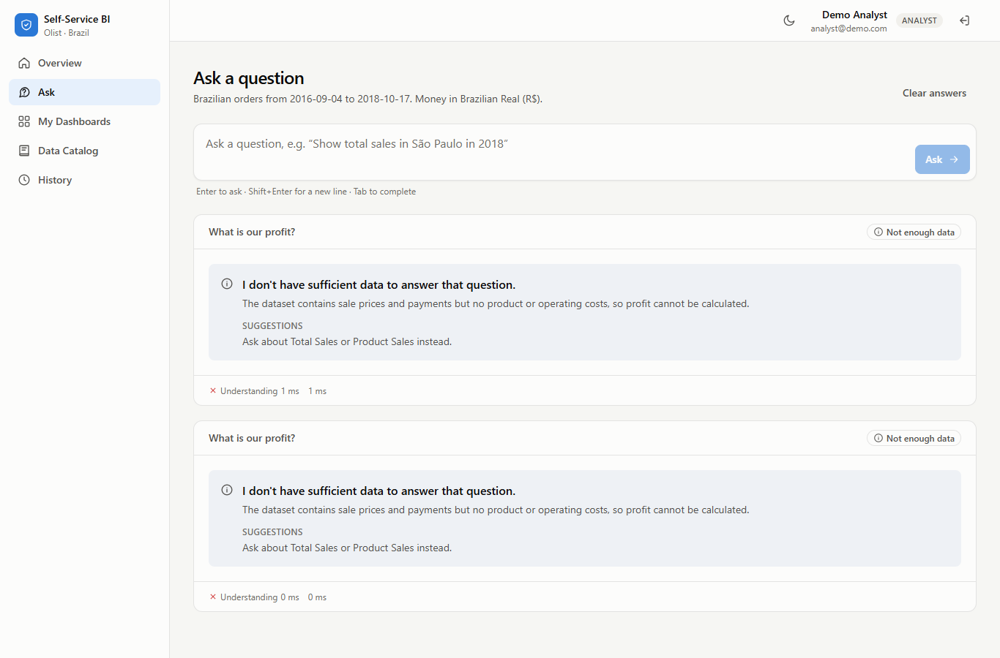
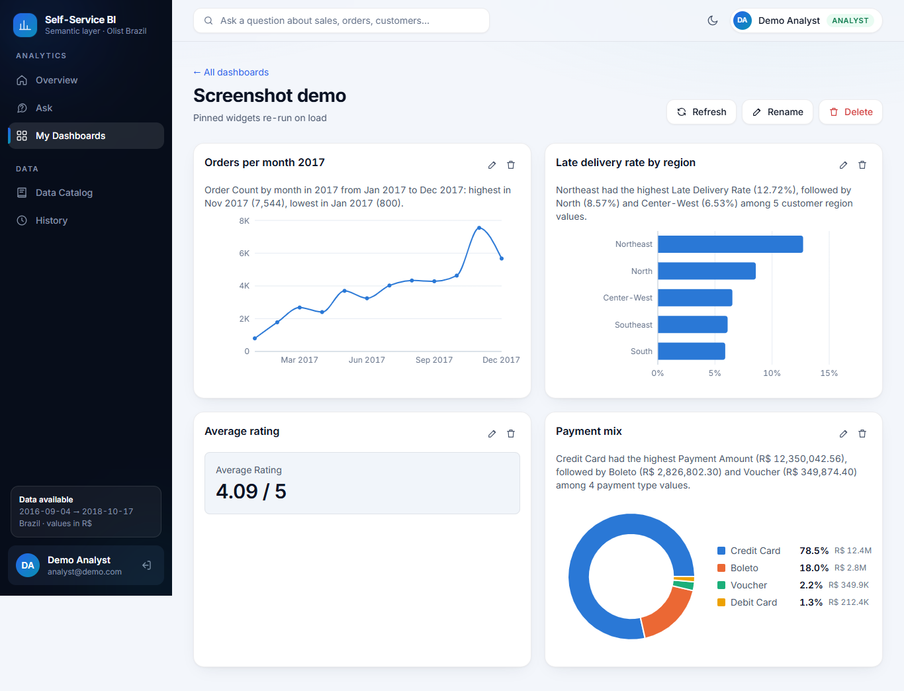
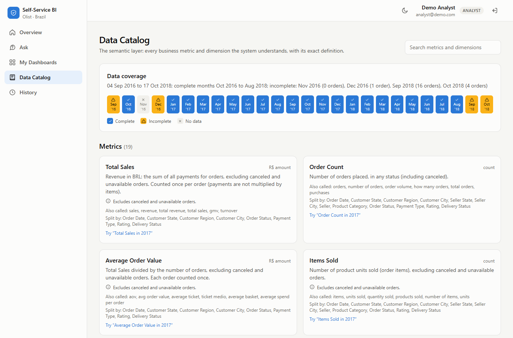
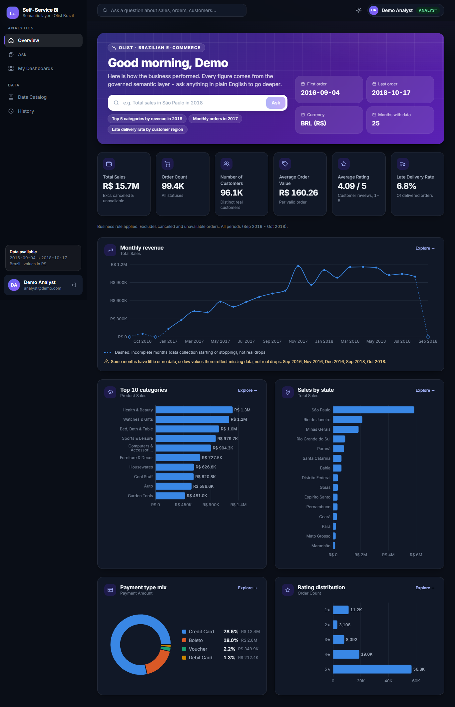
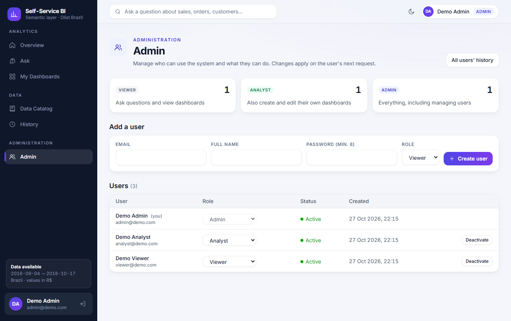
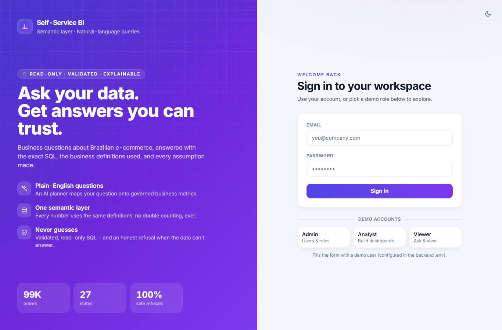
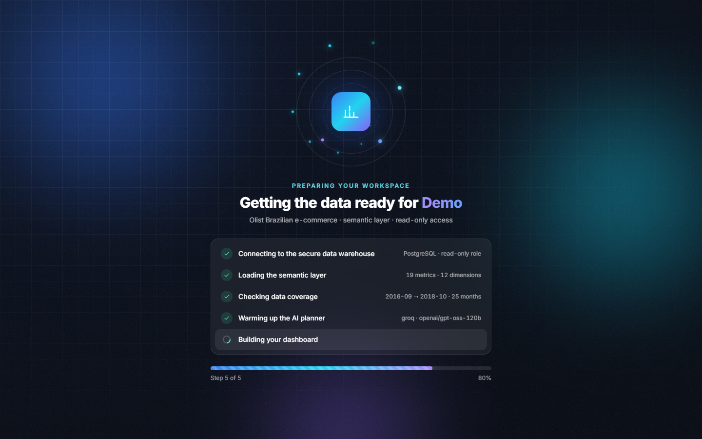
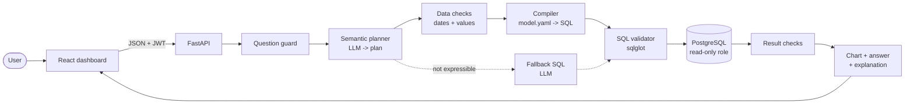

# Self-Service BI with a Semantic Layer and Natural-Language Queries

Ask business questions in plain English, such as *"Show total sales in São Paulo in 2018"*,
and get an answer you can trust: a KPI, chart or table, the SQL that produced it, and an
explanation of the business definitions used. Questions go through a YAML **semantic
layer**, an **LLM** that only picks business names (never writes the business logic), a
deterministic **SQL compiler**, a **SQL validator**, a **read-only** PostgreSQL role and
**result checks**. When the data cannot answer, the system says

> **I don't have sufficient data to answer that question.**

and explains why. It never guesses.

Data: the [Olist Brazilian E-Commerce dataset](https://www.kaggle.com/datasets/olistbr/brazilian-ecommerce)
(99,441 orders, Sep 2016 - Oct 2018, values in Brazilian Real).



## Highlights

- **Semantic layer** (`backend/app/semantic/model.yaml`): 19 business metrics and
  12 dimensions with definitions, synonyms, valid combinations, default rules (revenue
  excludes canceled/unavailable orders) and a list of concepts the data cannot answer.
- **No double counting**: facts at their own grain (orders / items / payments); measures
  from different tables are aggregated separately and joined on their results.
- **Layered safeguards**: question guard, unsupported concepts, time coverage, filter
  values, measure/dimension compatibility, SQL validation, read-only execution, result
  checks, clarification for ambiguous questions, confidence and assumptions on every answer.
- **Evaluation**: 85 questions, **96.2% execution accuracy** on the first full run (100%
  after two prompt fixes), **100% correct refusals**, **0 wrong answers**, **0 unsafe SQL**
  ([report](docs/evaluation_report.md)).
- **React dashboard**: ask page with autocomplete, result cards (chart/table, SQL,
  "how this was calculated", pin, CSV export), overview KPIs, saved dashboards that re-run
  on load, a data catalog and history; light and dark mode; animated aurora design and a
  "preparing your workspace" sequence after sign-in whose steps track the real data loading.

| | |
|---|---|
|  |  |
|  |  |
|  |  |
|  |  |

## Architecture



Details: [docs/architecture.md](docs/architecture.md) ·
[docs/semantic_layer.md](docs/semantic_layer.md) ·
[docs/safeguards.md](docs/safeguards.md) · [docs/api.md](docs/api.md) · [docs/deployment.md](docs/deployment.md) ·
[database/README.md](database/README.md)

## Technology

| Part | Stack |
|---|---|
| Frontend | React 18, Vite, TypeScript, Tailwind CSS, Recharts, React Router, Axios, TanStack Query |
| Backend | Python 3.11/3.12, FastAPI, pydantic, SQLAlchemy 2, psycopg 3, slowapi |
| AI | LangChain; providers Groq (used for the evaluation), Google Gemini, OpenAI, xAI - chosen in `.env` |
| Database | PostgreSQL 16+ installed locally (no Docker) |
| SQL safety | sqlglot |
| Auth | JWT (python-jose) + bcrypt (passlib) |
| Testing | pytest, Vitest + Testing Library |
| Quality | ruff, black, ESLint, Prettier |

## Setup on Windows (no Docker)

### 1. Install prerequisites

- **Python 3.12** (or 3.11) from python.org, with the `py` launcher. Newer versions
  (3.13+) may lack wheels for some packages.
- **Node.js 20+** (LTS) from nodejs.org.
- **PostgreSQL 16 or newer** from postgresql.org (the installer sets up the `postgres`
  superuser and the Windows service on port 5432). Remember the password.
- **Git**.
- An **LLM API key**: Groq (free tier works), Google Gemini, OpenAI or xAI.

### 2. Get the code and the data

```powershell
git clone <repo-url> Capstone
cd Capstone
```

Download the Olist dataset from Kaggle and put the 9 CSV files in `data\`
(`olist_orders_dataset.csv`, `olist_order_items_dataset.csv`, ... and
`product_category_name_translation.csv`). File names may carry prefixes; they are found
by pattern.

### 3. Configure `.env`

```powershell
powershell -ExecutionPolicy Bypass -File scripts\setup.ps1
```

The first run copies `.env.example` to `.env` and stops. Edit `.env`:

| Setting | What to put |
|---|---|
| `POSTGRES_SUPERUSER_PASSWORD` | your `postgres` password (used only by setup) |
| `BI_ADMIN_PASSWORD`, `BI_READER_PASSWORD` | choose passwords; use the same values in `ADMIN_DATABASE_URL` / `READER_DATABASE_URL` |
| `LLM_PROVIDER` | `groq`, `gemini`, `openai` or `grok` (xAI) |
| `GROQ_API_KEY` (or `GEMINI_API_KEY`, `OPENAI_API_KEY`, `XAI_API_KEY`) | your key; model names are set next to it |
| `JWT_SECRET` | a long random string |
| `DEMO_*` | demo user emails/passwords (seeded on first start) |

### 4. Install and create the database

```powershell
powershell -ExecutionPolicy Bypass -File scripts\setup.ps1
```

This creates `backend\.venv`, installs the Python and npm packages, and runs
`scripts\setup_db.py`, which creates database `bi_db`, schemas `raw`, `analytics`, `app` and
the roles `bi_admin` (owner) and `bi_reader` (read-only). It is safe to re-run.

### 5. Load the data

```powershell
powershell -ExecutionPolicy Bypass -File scripts\load_data.ps1
```

About 1.5 minutes. Prints row counts per table and verifies them (99,441 orders,
96,096 customers, R$ 16,008,872.12 total payments); exits with an error if any check fails.

### 6. Run

Two terminals:

```powershell
powershell -ExecutionPolicy Bypass -File scripts\run_backend.ps1    # http://localhost:8000/docs
powershell -ExecutionPolicy Bypass -File scripts\run_frontend.ps1   # http://localhost:5173
```

Open http://localhost:5173 and sign in.

## Free deployment

The whole system can run for $0 on Neon (PostgreSQL), Render (FastAPI) and Vercel (React),
with Groq for the LLM. Step-by-step guide: **[docs/deployment.md](docs/deployment.md)**
(`render.yaml`, `frontend/vercel.json` and `scripts/setup_cloud_db.py` are included).

## Demo accounts

Seeded from `.env` on first start (change them there):

| Role | Email | Password | Can |
|---|---|---|---|
| Admin | `admin@demo.com` | `Admin@123` | everything, plus the **Admin** page (create users, change roles, deactivate accounts) and all users' history |
| Analyst | `analyst@demo.com` | `Analyst@123` | ask, pin answers, build and edit own dashboards (**My Dashboards**) |
| Viewer | `viewer@demo.com` | `Viewer@123` | ask, export CSV, view dashboards shared by analysts (no pinning or editing) |

## Example questions

| Question | What happens |
|---|---|
| Show total sales in São Paulo in 2018 | R$ 1,270,521.80, with a warning that Sep-Oct 2018 are incomplete |
| Top 5 categories by revenue | Bar chart; uses Product Sales and says why |
| Monthly orders in 2018 | Line chart; incomplete months drawn dashed |
| Average rating for health and beauty | 4.14 / 5 |
| Late delivery rate in RJ | Single KPI with the definition |
| Revenue and number of customers by state | Two measures from different tables, no double counting |
| Which day of the week has the most orders? | Custom SQL (validated): Monday |
| Which category sells the most? | Asks: by product sales (R$) or by items sold? |
| What is our profit? | Refused: no cost data |
| Show sales in Hyderabad | Refused: Brazil only; lists the states that exist |
| Show last month's sales | Refused: data covers 04 Sep 2016 - 17 Oct 2018 |

## Tests and evaluation

```powershell
powershell -ExecutionPolicy Bypass -File scripts\test.ps1   # pytest (341) + Vitest (24)
powershell -ExecutionPolicy Bypass -File scripts\eval.ps1   # 85 questions -> docs\evaluation_report.md
```

- Backend tests cover YAML loading and validation, the compiler (every measure x dimension
  combination executed on PostgreSQL), the SQL validator (56 dangerous patterns), every
  safeguard, the planner (with a fake LLM), and the API (auth, roles, dashboards, rate limit).
  Database tests are skipped automatically when PostgreSQL is not reachable.
- The evaluation calls the real LLM. On a free tier it is slow (rate limits); subsets:
  `scripts\eval.ps1 --ids T01,X03` or `--kind refuse`.

## Project structure

```
data/                 Olist CSVs (not in git)
database/             raw schema, analytics model, loader
backend/app/
  semantic/           model.yaml, loader, catalog, compiler
  nl2sql/             LLM factory, prompts, planner, fallback SQL, relative dates, CLI
  safety/             question guard, data checks, SQL validator, result checks
  services/           query pipeline, executor, chart selector, explainer, overview
  routers/ models/ schemas/ auth/
backend/tests/        pytest suites + eval/ (questions.yaml, run_eval.py)
frontend/src/         pages, components, hooks, api, utils
docs/                 architecture, semantic layer, safeguards, API, evaluation report
scripts/              PowerShell helpers, setup_db.py, generate_semantic_docs.py
```

Developer CLI (same pipeline as the API):
`backend\.venv\Scripts\python.exe -m app.nl2sql.cli "Top 5 categories by revenue"` (run in `backend`).

## Semester mapping

| Semester | Scope | Status |
|---|---|---|
| **Semester 1** - working MVP | Phase 0 setup · Phase 1 database and loading · Phase 2 semantic layer · Phase 3 NL -> SQL (semantic planner + fallback) · Phase 4 SQL validation and safe execution · Phase 6 FastAPI backend · Phase 7 React dashboard | done |
| **Semester 2** - correctness | Phase 5 correctness safeguards · Phase 8 evaluation (85 questions, report) · Phase 9 documentation and polish | done |
| Semester 2 - optional extensions | CSV/Excel upload with an LLM-drafted semantic layer · row-level security (e.g. a regional manager sees one state) · follow-up questions with conversation context ("now only for 2018") | not started |

## Team

| Name | Role |
|---|---|
| *(add team members)* | |

## Notes and known limitations

- The evaluation ran on Groq's free tier (`openai/gpt-oss-120b`); its 8,000 tokens/minute
  limit makes back-to-back questions wait ~30 s. A paid tier or another provider removes this.
- Seller and customer identities are anonymised hashes in the dataset; "top sellers" shows IDs.
- Relative dates ("last month") are resolved against today's date, so they fall outside the
  2016-2018 data and are refused by design.
- PostgreSQL 18 was used during development; any version 16+ works.
