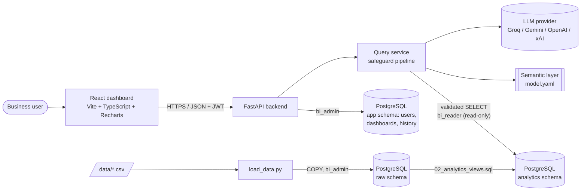
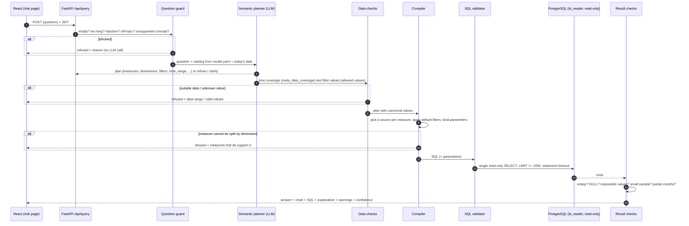
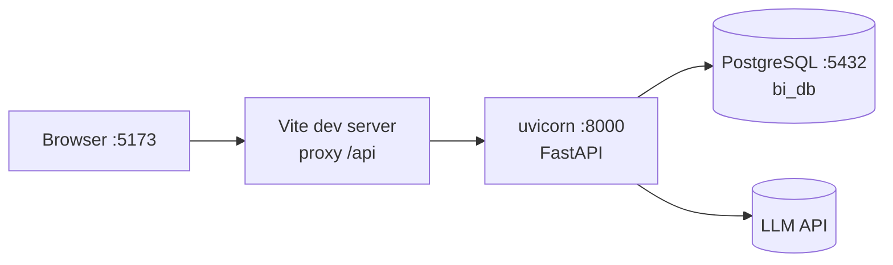

# Architecture

## System overview

| Layer | Technology | Responsibility |
|---|---|---|
| Frontend | React 18, Vite, TypeScript, Tailwind, Recharts, TanStack Query, React Router, Axios | Ask page, result cards, dashboards, data catalog, history; light/dark mode |
| API | FastAPI, pydantic, slowapi | Auth (JWT), routing, rate limiting, error handling, OpenAPI docs |
| Query service | Python | Orchestrates the safeguard pipeline and builds the standard response |
| Semantic layer | YAML + pydantic + sqlglot | Business definitions, allowed values, data coverage, compiler |
| NL layer | LangChain (Groq / Gemini / OpenAI / xAI) | Question -> structured semantic plan; fallback SQL generation |
| Safety | sqlglot, PostgreSQL roles | Question guard, data checks, SQL validator, read-only execution, result checks |
| Data | PostgreSQL 16+ (18 on the dev machine), pandas | `raw` (cleaned CSVs), `analytics` (facts/dimensions), `app` (application tables) |

## Request flow: one question

If the planner says the question is answerable but cannot be expressed with the
semantic layer (e.g. "which weekday has most orders"), **Mode B** asks the LLM for one
SELECT against the analytics tables. That SQL goes through the same validator; if it is
rejected the LLM gets one repair attempt with the validator's errors, and if it still fails
it is never executed.

## Pipeline steps and where they live

| # | Step | Module | Outcome on failure |
|---|---|---|---|
| 1 | Question guard: empty, too long, prompt injection, SQL commands, off-topic | `app/safety/question_guard.py` | refused, no LLM call |
| 2 | Unsupported concepts (profit, inventory, non-Brazil locations ...) | `app/safety/question_guard.py` + `model.yaml` | refused, no LLM call |
| 3 | Semantic planning (structured output, 1 repair attempt, relative dates vs today, explicit period enforced) | `app/nl2sql/planner.py`, `prompts.py`, `dates.py`, `llm.py` | refused / clarify |
| 4 | Time coverage | `app/safety/data_checks.py` | refused (outside) / warning (partial) |
| 5 | Filter values (accent-insensitive, state code/name, typo-tolerant) | `app/safety/data_checks.py`, `app/semantic/catalog.py` | refused with suggestions |
| 6 | Measure/dimension compatibility + compilation | `app/semantic/compiler.py` | refused with alternatives |
| 7 | SQL validation + read-only execution | `app/safety/sql_validator.py`, `app/services/sql_runner.py`, `query_executor.py` | refused / error |
| 8 | Result checks (no data, NULL, bounds, small samples, row cap) | `app/safety/result_checks.py` | refused / warning |
| 9 | Chart, answer sentence, explanation, confidence | `app/services/chart_selector.py`, `explainer.py`, `query_service.py` | - |

## Component responsibilities

**Database (`database/`)**
`01_raw_schema.sql` creates the cleaned `raw` tables with keys and indexes;
`load_data.py` finds the CSVs by pattern, cleans them and bulk-loads them with `COPY`;
`02_analytics_views.sql` builds the business model at the correct grain
(`fact_orders`, `fact_order_items`, `fact_payments`, dimensions, `meta_data_coverage`).
See [database/README.md](../database/README.md).

**Semantic layer (`backend/app/semantic/`)**
`model.yaml` (definitions), `loader.py` (strict validation at startup), `catalog.py`
(allowed values and coverage from the database, value matching), `compiler.py`
(plan -> parameterized SQL). See [semantic_layer.md](semantic_layer.md).

**NL layer (`backend/app/nl2sql/`)**
`llm.py` is the provider factory (Groq, Gemini, OpenAI, xAI from `.env`): temperature 0,
timeouts, retries with backoff, waiting on short per-minute rate limits, model fallback
with cool-down, quota detection and JSONL logging of every call. `planner.py` returns a
validated `QueryPlan`; `sql_generator.py` writes Mode B SQL.

**Safety (`backend/app/safety/`)**
Described step by step in [safeguards.md](safeguards.md).

**Services (`backend/app/services/`)**
`query_service.py` runs the pipeline and builds the standard response; `sql_runner.py` is
the only path from SQL to the database; `query_executor.py` enforces the read-only role,
transaction and timeout; `overview.py`, `suggestions.py`, `history.py` support the UI.

**API (`backend/app/routers/`)**
Auth, query, metadata, dashboards, history, health. See [api.md](api.md).

**Frontend (`frontend/src/`)**
`pages/` (Overview, Ask, Dashboards, Catalog, History, Login), `components/`
(ResultCard, ChartView, QuestionBox, DataTable, SqlPanel, PinDialog ...), `hooks/`
(auth, theme, data queries, ask session), `api/` (typed client), `utils/` (BRL formatting,
CSV export, SQL highlighting).

## Security model

| Concern | Control |
|---|---|
| Users | JWT (HS256, expiry), bcrypt password hashes, roles admin / analyst / viewer |
| Who runs user queries | Only `bi_reader`: `SELECT` on `analytics` only, `default_transaction_read_only = on`, statement timeout, verified on first use; the executor refuses `bi_admin` / `postgres` |
| What SQL can run | sqlglot validator: one SELECT, analytics tables and catalog columns only, no dangerous functions, declared joins only, no cartesian joins or fan-out, LIMIT <= MAX_ROWS |
| Prompt injection | Pre-LLM guard; the question is treated as data in prompts; plans contain names, not SQL |
| Abuse | Per-user rate limit on `/api/query` (default 30/minute) |
| Secrets | Only in `.env` (git-ignored); no keys in code |
| Errors | Global handlers return JSON with a request ID; internals are logged, never returned |

## Deployment (development, Windows, no Docker)

`scripts/run_backend.ps1` and `scripts/run_frontend.ps1` start the two processes; the Vite
dev server proxies `/api` to the backend so the browser talks to a single origin.
